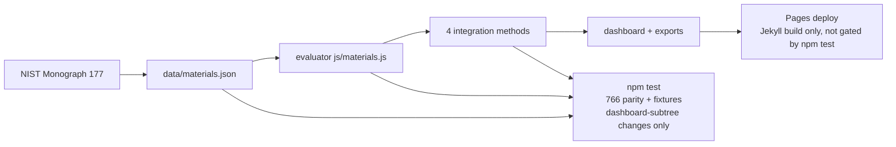

# document-organization-system — cryogenic material property dashboard and outward artefact worker

<!-- markdownlint-disable MD001 MD013 MD022 MD029 MD031 MD032 MD033 MD040 MD060 -->

[](cryo_dashboard_v0_3_0/cryo_dashboard_v0_3_0/VERSION)
[](https://github.com/GBOGEB/document-organization-system/actions/workflows/jekyll-gh-pages.yml)
[](https://github.com/GBOGEB/document-organization-system/actions/workflows/modular-ci-audit.yml)
[](LICENSE)

> **Hosts the SCK CEN cryogenic material property dashboard (10 NIST materials, k(T), cp(T) and thermal contraction from 1 to 300 K) with a 766-case NIST parity suite, plus the federation's outward-artefact and book-contract tooling.**

## At a glance

| | |
|---|---|
| **Domain** | Cryogenic material properties for engineering calculations (heat load, cool-down energy, contraction) and outward artefact packaging: file indexes, navigation, the DOCX/RTM adapter and the GLOOB book contracts |
| **EPICs carried here** | **Dashboard v0.4.x** ([changelog](docs/CHANGELOG.md)) · **Federation SSOT hub** slice 05 ([#81](https://github.com/GBOGEB/document-organization-system/pull/81), [FEDERATION_HUB.md](docs/FEDERATION_HUB.md)) · **Level-1 worker** ([LEVEL1.md](LEVEL1.md)) · **GLOOB** book and control contracts ([gloob/](gloob/README.md)). · **v0.4.9 GitHub Release** ([#51](https://github.com/GBOGEB/document-organization-system/issues/51)) · **Read-only Drive VFS/HMI satellite** ([#84](https://github.com/GBOGEB/document-organization-system/issues/84)) |
| **Owner and decision authority** | Repository owner **GBOGEB**: admission to the default branch, releases and every external grant. No agent, bot or CI verdict holds this authority. |
| **Role in the federation** | An *outward-artefact property worker* (Level-1 role `OUTWARD_ARTIFACT_PROPERTY_WORKER`): it publishes calculated views and indexes; receipts route through the Hub. |
| **Owns** | `data/materials.json` (NIST coefficient database) and the dashboard runtime, the parity tests, file indexes, `gloob/` contracts, the `adapters/docx_rtm` projection |
| **Does not own** | The federation registry of record (CODEX) · engineering truth and design decisions (cryoplant-project) · DOW analysis (ABACUS) · RTM content |
| **Status snapshot** | `main@a7da827`, read 15 November 2026 — 1 open issues, 0 open PRs. [Details ↓](#6-status-and-open-gates) |

**New here?** Read [§1](#1-why-document-organization-system-exists--bios), then the route that matches you:

| I want to… | Open this first |
|---|---|
| Use the dashboard now, no install | [Hosted dashboard](https://gbogeb.github.io/document-organization-system/cryo_dashboard_v0_3_0/cryo_dashboard_v0_3_0/index.html) (Pages deploy green on 14 Nov 2026) |
| Check the numbers are right | [Spot-check reference values](#spot-check-reference-values) and the [NIST parity report](cryo_dashboard_v0_3_0/cryo_dashboard_v0_3_0/docs/NIST_PARITY_TEST_REPORT_v0.4.9.md) |
| Find any file | [`files.html`](cryo_dashboard_v0_3_0/cryo_dashboard_v0_3_0/files.html) and [`file_index.yaml`](cryo_dashboard_v0_3_0/cryo_dashboard_v0_3_0/file_index.yaml) |
| Run the tests | [Run it locally](#7-run-it-locally) |
| See how it links to the federation | [`docs/FEDERATION_HUB.md`](docs/FEDERATION_HUB.md) |

## 1. Why document-organization-system exists — BIOS

**B — Baseline.** Dashboard **v0.4.9** (`VERSION`, tag `v0.4.9`). The legacy self-contained v1.10 HTML is kept but deprecated since v0.4.6.

**I — Identity and integrity.** `data/materials.json` is the single coefficient source; `scripts/version-coherence-check.js` keeps `VERSION`, file indexes and pages in step.

**O — Orchestration with ownership.** One calculation runtime (`js/`); the federation registry here is a pointer, and CODEX stays the registry of record. Promotion to an active satellite entry is a human review.

**S — Safety and source-qualified status.** 766 NIST parity tests, Romberg-referenced regression fixtures and schema validation run under `npm test`. Results are engineering aids, not design acceptance.

**Where authority lives:** [`cryo_dashboard_v0_3_0/cryo_dashboard_v0_3_0/data/materials.json`](cryo_dashboard_v0_3_0/cryo_dashboard_v0_3_0/data/materials.json) (coefficients) · [`cryo_dashboard_v0_3_0/cryo_dashboard_v0_3_0/VERSION`](cryo_dashboard_v0_3_0/cryo_dashboard_v0_3_0/VERSION) · [`cryo_dashboard_v0_3_0/cryo_dashboard_v0_3_0/ssot.json`](cryo_dashboard_v0_3_0/cryo_dashboard_v0_3_0/ssot.json) · [`federation/registry.json`](federation/registry.json) · [`LEVEL1.md`](LEVEL1.md).

## 2. From source to decision

1. NIST Monograph 177 equations and coefficients → `data/materials.json`.
2. Evaluator (`js/materials.js`) computes k, cp and contraction at temperature.
3. Four integration methods (Trapezoid, Simpson, Romberg, Gauss–Legendre) give ∫k dT, ∫cp dT and ΔL.
4. Parity, numerics, export and schema tests gate every change.
5. Version coherence regenerates indexes; Pages publishes the static site; that deploy depends only on the Jekyll build, not on `npm test`.
6. Receipts and pointers route to the federation through the Hub; engineers apply the numbers.

## 3. What is inside

| Block | Native source | Input → output | Boundary |
|---|---|---|---|
| Dashboard runtime | [`cryo_dashboard_v0_3_0/cryo_dashboard_v0_3_0/js/`](cryo_dashboard_v0_3_0/cryo_dashboard_v0_3_0/js/), [`dashboard_modular.html`](cryo_dashboard_v0_3_0/cryo_dashboard_v0_3_0/dashboard_modular.html) | Material, property, T range → values, integrals, Q̇, energy, ΔL | Within 1–300 K and each material's fit range |
| Coefficient database | [`data/materials.json`](cryo_dashboard_v0_3_0/cryo_dashboard_v0_3_0/data/materials.json) | NIST fits → 10 materials | Published correlations, not new measurements |
| Tests | [`cryo_dashboard_v0_3_0/cryo_dashboard_v0_3_0/tests/`](cryo_dashboard_v0_3_0/cryo_dashboard_v0_3_0/tests/) | Fixtures → parity, numerics, export, schema, index checks | Equation parity, not experimental validation |
| Navigation and indexes | [`index.html`](cryo_dashboard_v0_3_0/cryo_dashboard_v0_3_0/index.html), [`files.html`](cryo_dashboard_v0_3_0/cryo_dashboard_v0_3_0/files.html), [`file_index.json`](cryo_dashboard_v0_3_0/cryo_dashboard_v0_3_0/file_index.json) | Repo files → navigator | A view |
| Federation hub | [`federation/`](federation/), [`contracts/`](contracts/), [`federation_hub.html`](cryo_dashboard_v0_3_0/cryo_dashboard_v0_3_0/federation_hub.html) | Registry → cross-repo pointers | Pointer, not registry of record |
| DOCX/RTM adapter | [`adapters/docx_rtm/`](adapters/docx_rtm/README.md) | Bridge contract → projection | Projection only |
| GLOOB contracts | [`gloob/`](gloob/README.md) | Book, control-plane and dispatch contracts | Contracts and controllers, not content |
| Level-1 worker | [`level1/`](level1/), [`skill/`](skill/) | Runtime → MIP receipts | Receipts, not acceptance |

### What the dashboard computes

```text
THERMAL CONDUCTIVITY k(T)  [W/(m·K)]
  k at T1, k at T2
  ∫k(T)dT  [W/m]     — integral over T1→T2
  Qdot     [W]       — (A [m²] / L [m]) × ∫k dT

SPECIFIC HEAT cp(T)  [J/(kg·K)]
  cp at T1, cp at T2
  ∫cp(T)dT [J/kg]    — integral over T1→T2
  Energy   [J]       — m [kg] × ∫cp dT  (cooldown/warmup energy)

THERMAL CONTRACTION Y(T)  [×10⁻⁵]  (v0.4.9, 5 materials)
  Y = (L(T) − L₂₉₃) / L₂₉₃
  Strain   [m/m]
  ΔL       [m]       — between T1 and T2
```

**Integration methods available:** Trapezoid · Simpson 1/3 · Romberg ·
Gauss-Legendre 4-pt

**Compare All mode** runs all four methods simultaneously and reports %
deviation vs Romberg.

### Spot-check reference values

Use these to verify the dashboard is computing correctly after setup. Set 100
integration steps, use the Romberg method.

| Material | Property | T1 (K) | T2 (K) | Expected ∫ (Romberg) | Units |
|---|---|---|---|---|---|
| AISI316 | k | 20 | 300 | **3 012.150** | W/m |
| AISI316 | cp | 20 | 300 | **93 190.19** | J/kg |
| CuRRR100 | k | 4 | 300 | **194 330.57** | W/m |

> These values are the authoritative regression fixtures from
> [`tests/numerics.test.js`](cryo_dashboard_v0_3_0/cryo_dashboard_v0_3_0/tests/numerics.test.js). Trapezoid will differ slightly (expect ~0.04% lower
> on smooth curves); Romberg and Gauss-Legendre agree to < 0.001%.

### Materials (10)

| # | Key | Name | k | cp | tc |
|---|---|---|---|---|---|
| 1 | AISI316 | AISI 316 Stainless Steel | ✅ | ✅ | ✅ |
| 2 | Al6061T6 | Aluminum 6061-T6 | ✅ | ✅ | ✅ |
| 3 | G10Normal | G-10 CR Fiberglass (Normal) | ✅ | ✅ | — |
| 4 | G10Warp | G-10 CR Fiberglass (Warp) | ✅ | — | ✅ |
| 5 | CuRRR50 | Copper RRR=50 | ✅ | ✅ | — |
| 6 | CuRRR100 | Copper RRR=100 | ✅ | ✅ | — |
| 7 | CuRRR150 | Copper RRR=150 | ✅ | ✅ | — |
| 8 | CuRRR300 | Copper RRR=300 | ✅ | ✅ | — |
| 9 | CuRRR500 | Copper RRR=500 | ✅ | ✅ | — |
| 10 | Ti64 | Titanium Ti-6Al-4V | ✅ | ✅ | ✅ |

Source: NIST cryogenic properties database. All coefficients validated against
NIST reference values.

## 4. Where document-organization-system sits in the federation

| Neighbour | Keeps | Interface with document-organization-system |
|---|---|---|
| [CODEX](https://github.com/GBOGEB/CODEX) | Federation governance, contracts, wave roll-up | Registry of record; satellite promotion is a human review |
| [pipeline-automation-hub](https://github.com/GBOGEB/pipeline-automation-hub) | Routing, JADE census, Mission Control | Routes this worker's receipts |
| [cryoplant-project](https://github.com/GBOGEB/cryoplant-project) (private) | QPS engineering SSOT and release identity | Engineering truth that consumes the numbers |
| [DOCX_RTM_Automation](https://github.com/GBOGEB/DOCX_RTM_Automation) | DOCX ↔ RTM tooling | Source for the `adapters/docx_rtm` bridge |

## 5. Process diagrams

Declared architecture, not a run receipt.



## 6. Status and open gates

**Snapshot: `main@a7da827`, read 15 November 2026.** Rows point at live owners; open the link for the current position.

| Gate | Status | What would close it |
|---|---|---|
| Dashboard v0.4.9 | Tagged `v0.4.9`; no GitHub Release object ([#51](https://github.com/GBOGEB/document-organization-system/issues/51)) | Owner publishes a Release from the tag |
| Pages | Jekyll deploy **succeeded** on `main` (14 Nov 2026); the hosted URL was not opened in this pass | Browser check of the hosted pages |
| Satellite promotion | Registered locally; **not yet an ACTIVE satellite** in the CODEX registry | Human review in CODEX |
| Root clutter | Root holds dated v0.4.9 deployment and 18 May status reports (DOCX/MD/PDF) and one-off scripts | Move them under `docs/` or `handover/` in a separate PR |

## 7. Run it locally

The dashboard runtime is Node (CI uses Node 20); tests need no dependencies.

```bash
cd cryo_dashboard_v0_3_0/cryo_dashboard_v0_3_0
npm test                 # numerics, export, schema, indexes, version coherence, NIST parity, contracts
python3 -m http.server 8000   # then open http://localhost:8000/index.html
```

`dashboard_modular.html` needs HTTP (ES6 modules); the legacy `material_properties_dashboard_v1_10.html` also opens by double-click. Release gate for v0.4.x: `npm test` → validation → bump `VERSION` → push.

## 8. Evidence rules and non-compensation

- **Parity before release**: the NIST suite and Romberg fixtures must pass before a version bump (a release-process rule; CI runs them only for dashboard-subtree changes and does not gate Pages).
- **Fit range is the limit**: values outside 1–300 K or a material's fit are not claimed.
- **Pointer, not registry**: CODEX holds the registry of record.
- **Numbers aid, engineers decide.**

## 9. Repository map and next actions

| Folder | Open it for |
|---|---|
| [`cryo_dashboard_v0_3_0/cryo_dashboard_v0_3_0/`](cryo_dashboard_v0_3_0/cryo_dashboard_v0_3_0/) | Dashboard, data, tests, indexes |
| [`docs/`](docs/) | Changelog, federation hub, deploy notes |
| [`federation/`](federation/), [`contracts/`](contracts/) | Cross-repo registry and schema |
| [`gloob/`](gloob/README.md) | Book and control contracts |
| [`adapters/`](adapters/) | DOCX/RTM bridge |
| [`level1/`](level1/), [`skill/`](skill/), [`MIP/`](MIP/) | Level-1 worker |
| [`handover/`](handover/), [`triage/`](triage/) | Handover and triage |

**Next actions** (match §6): browser-check the hosted pages → CODEX review for satellite promotion → tidy dated root reports → optional GitHub Release for v0.4.9.

---

BIOS: Baseline · Identity · Orchestration · Safety. Admission authority: **GBOGEB**. Licence: [Apache-2.0](LICENSE). Organisation: SCK CEN. Landing R2 on the [GEMINI skeleton](https://github.com/GBOGEB/GEMINI/blob/main/docs/landing/LANDING_SKELETON.md), snapshot `main@a7da827`.
